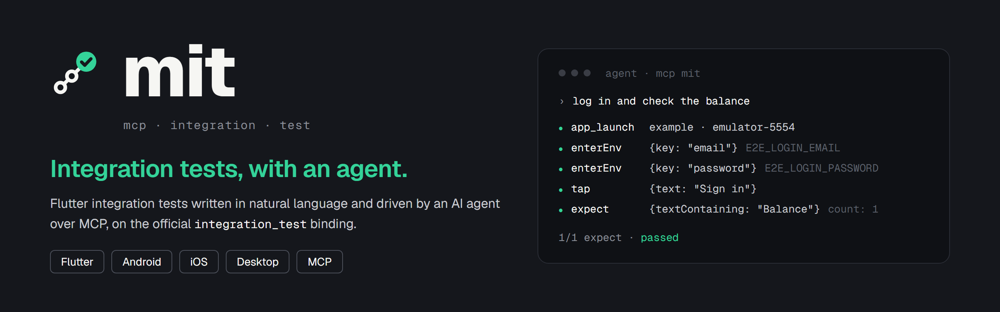
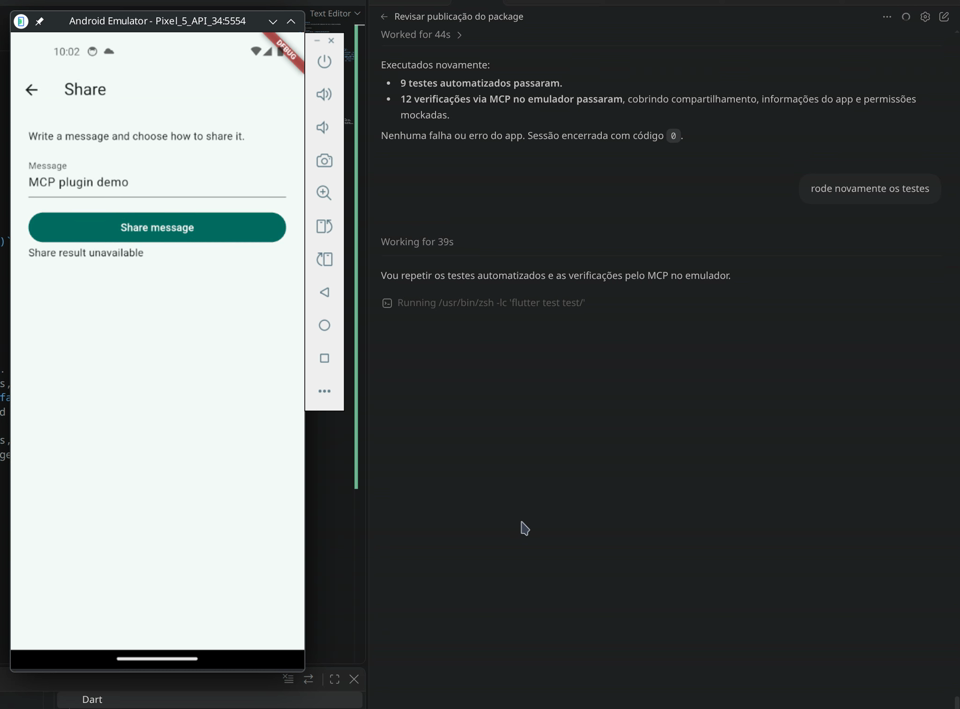

# mcp-integration-test

A variant of Flutter's [`integration_test`](https://docs.flutter.dev/testing/integration-tests)
that you drive through a **local MCP server**. The app is built from a dedicated
entry point (`integration_test/mcp_test.dart`); inside it, a single long-lived
`testWidgets` runs on the real `IntegrationTestWidgetsFlutterBinding` and executes
commands (tap, enterText, scroll, expect, screenshot…) sent by the MCP server.

```
MCP client (Claude)  --stdio-->  mcp_integration_test_server  --HTTP 127.0.0.1:8765-->  app (mcp_integration_test)
                                       |                                                     WidgetTester + finders
                                       +-- starts the app with `flutter run` or `flutter test`
```

## Demo

[](docs/assets/demo.webm)

[▶ Watch the full demo (40 seconds, WebM)](docs/assets/demo.webm)

## 1. Add to your app

```yaml
# pubspec.yaml
dev_dependencies:
  integration_test: { sdk: flutter }
  mcp_integration_test: ^0.1.0
```

```dart
// integration_test/mcp_test.dart
import 'package:my_app/main.dart' as app;
import 'package:mcp_integration_test/mcp_integration_test.dart';

void main() => mcpIntegrationTest(app.main);
```

Production builds (`lib/main.dart`) never include it.

## 2. Register the MCP server

The server is a separate package (`packages/mcp_integration_test_server`), so
its dependencies (`dart_mcp`…) never enter your app's dependency graph. Install
it once with the Dart from your Flutter SDK:

```bash
dart pub global activate mcp_integration_test_server
```

The server depends on a shared pure Dart protocol package and does not depend
on Flutter packages. Flutter must still be on `PATH` to launch the app.

### Claude Code

```bash
claude mcp add flutter-it -- dart pub global run mcp_integration_test_server
```

To use this repository's `.mcp.json` instead, activate the server as shown
above, then open Claude Code at the repository root.

### Codex

Register the local STDIO server with the Codex CLI:

```bash
codex mcp add flutter-it -- dart pub global run mcp_integration_test_server
codex mcp list
```

Codex stores the entry in `~/.codex/config.toml`. Set `tool_timeout_sec` to
`660` in that entry so `app_launch` can wait for its default 600-second build
timeout. Alternatively, add the complete entry directly:

```toml
[mcp_servers.flutter-it]
command = "dart"
args = ["pub", "global", "run", "mcp_integration_test_server"]
tool_timeout_sec = 660
```

You can also use a project-scoped `.codex/config.toml` in a trusted project.
In the desktop app, open **Settings → MCP servers → Add server**, choose
**STDIO**, and enter the same command and arguments. Save and select **Restart**;
in the IDE extension, select **Restart extension**. Use `/mcp` in the desktop
app or Codex CLI to check connected servers.

Ensure `dart`, `flutter`, and (for Android) `adb` are available on the MCP
server's `PATH`. See the [official MCP configuration documentation](https://learn.chatgpt.com/docs/extend/mcp).

### Environment variables

Pass them with `claude mcp add -e KEY=VALUE …` (or `env` in the Codex entry):

| Variable | Default | Purpose |
|---|---|---|
| `MCP_IT_PORT` | `8765` | Port of the in-app server for `app_connect` and manually started apps |
| `MCP_IT_URL` | `http://127.0.0.1:$MCP_IT_PORT` | Initial app URL (before `app_launch` / `app_connect`) |
| `MCP_IT_ENV_FILE` | none | `KEY=VALUE` file read by `enterEnv` / `envKeys` (secrets stay out of the chat) |
| `MCP_IT_SHOT_WIDTH` | `360` | Max width of the `shot` screenshots taken after actions |

## 3. Use it

Ask the agent to `app_launch` (projectDir + device), or start the build yourself:

```bash
flutter run -d <device> -t integration_test/mcp_test.dart      # or:
flutter test integration_test/mcp_test.dart -d <device>        # official flow
# Android/emulator: adb forward tcp:8765 tcp:8765   (app_launch does it with adbForward: true)
```
then `app_connect`. Port: `--dart-define=MCP_IT_PORT=1234` (+ `MCP_IT_PORT` env for the server).

`app_launch` automatically selects a free local port when `port` is omitted and
returns its URL. Pass `port` to request a specific port; an occupied port fails
before launching Flutter. With `adbForward: true`, `app_stop` removes the ADB
forward created by that launcher, including when the Flutter process has already
exited. Separate MCP server sessions can launch apps concurrently on different
ports. Manually started apps and `app_connect` still default to port 8765 (or
`MCP_IT_PORT`).

### Tools

| Group | Tools |
|---|---|
| Lifecycle | `app_launch`, `app_connect`, `app_restart`, `app_logs`, `app_stop` |
| Inspect | `app_status`, `snapshot`, `find`, `getText`, `screenshot` |
| Act | `tap`, `longPress`, `doubleTap`, `tapAt`, `enterText`, `enterEnv`, `drag`, `fling`, `scrollUntilVisible`, `pressBack`, `sendKey` |
| Test data | `envKeys` |
| Timing | `pump`, `pumpAndSettle`, `waitFor` |
| Assert | `expect`, `test_results`, `app_errors` |

Finders: `{text | textContaining | key | type | tooltip | semanticsLabel, index, within, includeOffstage}`.
Actions pump and wait for animations by default (never fails on endless animations).

`expect` failures don't end the session; `app_stop` ends the test, so with
`mode: "test"` the process exits non-zero, like a normal integration test.

`app_restart` puts the app back on its initial screen with fresh state, so leftovers from a previous run
(a filled field, a pushed route) don't leak into the next one:

- App started by `app_launch` with `mode: "run"`: **hot restart** (`R` on `flutter run`). Everything is reset,
  static and global state included.
- `mode: "test"` or `app_connect`: **soft restart**. The widget tree is unmounted (every State, route and controller is
  disposed) and the app's `main()` runs again. Static fields, singletons (e.g. `get_it`), a global router and state
  restoration are **not** reset; if `main()` can't run twice, the restart fails and the screen stays empty.
- Expectation counters are **preserved** in both cases: `test_results`, `app_status` and `app_stop` include what was
  recorded before the restart. Unacknowledged app errors are lost on a hot restart (check `app_errors` first).
- In `mode: "run"` the in-app test only sees failures recorded after the last hot restart; `app_stop` reports them all.
  A manual `R` in a terminal (with `app_connect`) loses the earlier counters.

## Local development

Keep hosted version constraints in the published manifests. To use the local
protocol package, create an ignored `pubspec_overrides.yaml` in both
`packages/mcp_integration_test` and `packages/mcp_integration_test_server`:

```yaml
dependency_overrides:
  mcp_integration_test_protocol:
    path: ../mcp_integration_test_protocol
```

Create the same file in `example/`, using
`path: ../packages/mcp_integration_test_protocol`. Then resolve dependencies:

```bash
cd packages/mcp_integration_test_protocol
dart pub get
cd ../mcp_integration_test
flutter pub get
cd ../mcp_integration_test_server
dart pub get
dart test
cd ../../example
flutter pub get
```

To run the server from source, use
`dart run packages/mcp_integration_test_server/bin/mcp_integration_test_server.dart`
from the repository root. This can also replace the arguments in `.mcp.json`
with `["run", "packages/mcp_integration_test_server/bin/mcp_integration_test_server.dart"]`.

## Publishing

All three packages start at version `0.1.0`. Publish in dependency order:

1. `packages/mcp_integration_test_protocol`
2. `packages/mcp_integration_test`
3. `packages/mcp_integration_test_server`

Before validating a release, remove local `pubspec_overrides.yaml` files
from the package directories so validation uses hosted dependencies. After
publishing each dependency, wait until its version resolves from pub.dev before
validating the next package. Run `dart pub publish --dry-run` in the protocol
and server directories, and `flutter pub publish --dry-run` in the Flutter
package directory. Review the included files and validation output, then run
the corresponding publish command without `--dry-run` when ready.

Restore the local overrides described above to resume local development.
The example remains unpublished and uses the local Flutter package.

## Notes / limits

- Requires Flutter **>= 3.35.0** (Dart 3.9).
- Needs `dart:io`: mobile and desktop, **not Flutter web**.
- The in-app server binds to loopback only and rejects requests with an `Origin` header or a non-JSON content type.
- Screenshots use the render layer (debug/profile builds), so they work on every platform without the native plugin.
- App errors (RenderFlex overflow, build/layout/paint exceptions, errors thrown in gesture callbacks) are collected with
  kind, count, triggering command and stack, and returned as `appErrors` in the response of the command that caused them
  (also via `app_errors`). They don't kill the session, but they **fail the test at `app_stop`** unless acknowledged with
  `app_errors {clear: true}` or `app_stop {ignoreErrors: true}`, like the official `integration_test`.
  Overflow is only reported by debug builds. Errors thrown from async code outside the framework's error zone are not captured yet.

## Development

[](https://github.com/lucasnsa/mcp-integration-test/actions/workflows/ci.yml)

```bash
# In-app package: FinderSpec, snapshot, in-app server, soft restart
cd packages/mcp_integration_test && flutter test

# MCP server: launcher, app client
cd packages/mcp_integration_test_server && dart test

# End to end: drives example/ headless (flutter-tester) through the real MCP server
cd packages/mcp_integration_test_server && dart test -P e2e
```

CI (GitHub Actions) runs analysis, the tests above and the end-to-end session on Linux with Flutter 3.35.0 and
stable, and the MCP server tests plus the end-to-end session on Windows.

## Authors

| [Lucas Náiade](https://github.com/lucasnsa) | [Kauê Martins](https://github.com/kmartins) | [Eduardo Vilar](https://github.com/vilar95) |
| :---: | :---: | :---: |
| [](https://github.com/lucasnsa) | [](https://github.com/kmartins) | [](https://github.com/vilar95) |
